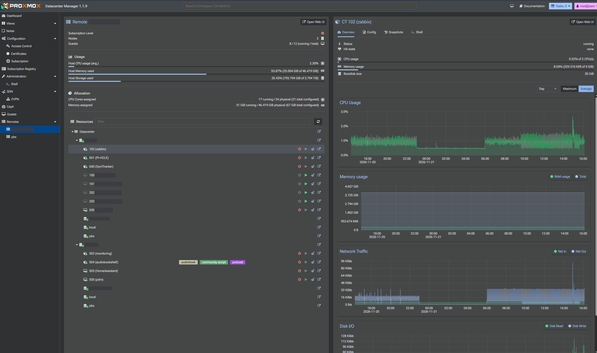
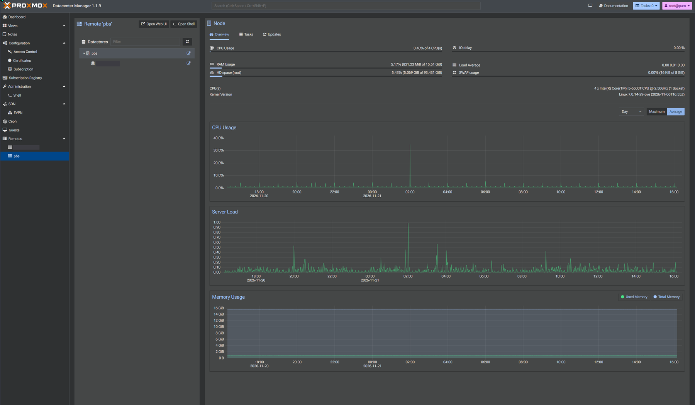

# Proxmox Datacenter Manager (PDM)

[Proxmox Datacenter Manager](https://pdm.proxmox.com) gives one web UI over the whole homelab: the [Proxmox VE cluster](https://github.com/nashibbhattrai766-max/proxmox-cluster) **and** the [Proxmox Backup Server](https://github.com/nashibbhattrai766-max/proxmox-backup-server).

What it's used for here:
- One dashboard for both nodes, every VM/CT and the backup datastore.
- Start / shut down / migrate guests (deeper settings open the normal PVE UI already logged in).
- **Updates across all three boxes in one panel**, applied through the built-in remote shell.

Nothing depends on it, so it can be rebuilt or switched off at any time.

## Install

1. Download the PDM ISO to a node (`local > ISO Images > Download from URL`).
2. Create and boot the VM: [`create-pdm-vm.sh`](create-pdm-vm.sh) (2 vCPU, 4 GB RAM, 20 GB disk, UEFI).
3. In the VM console run the installer and set hostname, static IP and DNS.
4. When `login:` appears, eject the ISO: `qm set <id> --ide2 none,media=cdrom`.
5. Browse to `https://<pdm-ip>:8443`, log in as `root` (realm *Linux PAM*).
6. **Administration → Repositories**: disable *pdm-enterprise*, add *No-Subscription*, then run updates.
7. **Remotes → Add → Proxmox VE**: enter one node's IP, accept the fingerprint, log in as `root@pam` and let PDM **create its own API token** (your password isn't stored). It discovers every cluster node; keep all of them as endpoints, using IPs rather than hostnames.
8. **Remotes → Add → Proxmox Backup Server**: `pbs-ip:8007`, same steps.
9. In the PDM shell: `apt install -y qemu-guest-agent && systemctl start qemu-guest-agent`.

Also recommended: enable **TOTP two-factor** for root (it holds tokens to every node), reserve the IP in your router, and keep it LAN-only.

## Troubleshooting: stuck at "Booting from Hard Disk..."

The first install used legacy BIOS (SeaBIOS) and `cpu: host`. After installation the VM never got past `Booting from Hard Disk...`, even though the disk had all three partitions. Switching the VM to **UEFI (OVMF, q35)** with the default **x86-64-v2-AES** CPU type and re-installing fixed it. Tip: don't eject the ISO until the installer has finished *and* the VM has rebooted to a `login:` prompt — ejecting mid-install leaves a black screen.

## License

MIT
